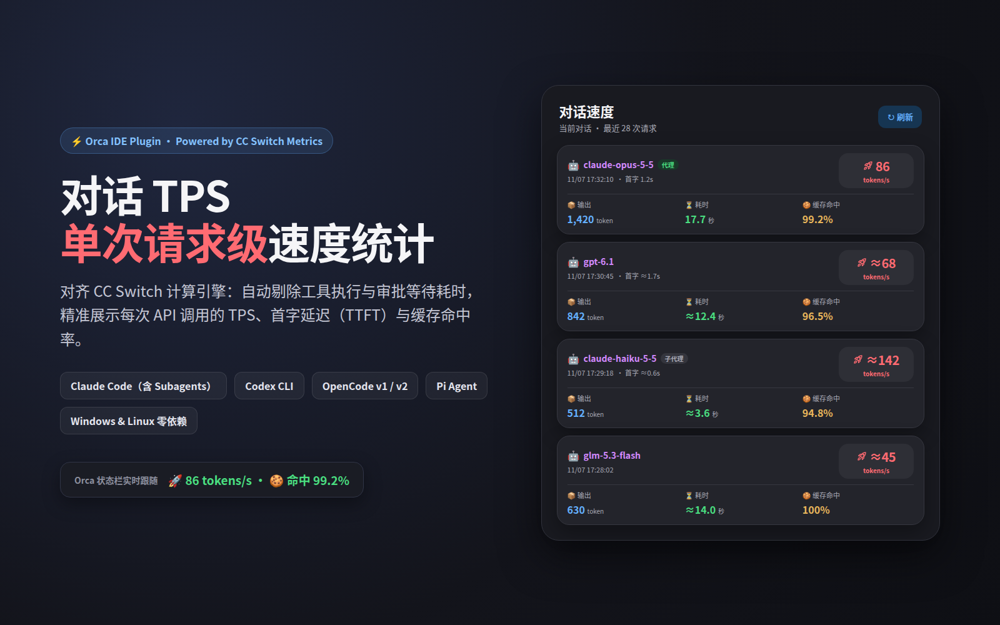

# Orca TPS Stats Plugin (对话 TPS)

[简体中文](./README.md) | [English](./README.en.md)

[](./LICENSE)
[](https://github.com/stablyai/orca)
[](https://nodejs.org/)
[](https://github.com/jecyxyf/Orca-TPS-Plugin/actions/workflows/ci.yml)



Real-time **per-request** output speed (TPS), time-to-first-token (TTFT), model, and prompt-cache hit rate monitor for **Orca IDE (`>= 1.4.251`)**. Powered by a zero-dependency calculation engine 100% aligned with [CC Switch](https://github.com/farion1231/cc-switch), excluding local tool execution and permission wait times across **Linux** and **Windows**.

---

## Highlights

- **Live Status Bar Follow**: Automatically tracks the focused Orca workspace, tab, and split terminal pane, displaying the latest API request's speed and cache hit rate (e.g. `🚀 ≈68 tokens/s · 🍪 命中 99.2%`, or `🚀 86 tokens/s` with local proxy TTFT).
- **Per-Request Sidebar Cards**: Inspect up to the 100 most recent API calls in the current conversation with model ID, completion timestamp, TTFT, output tokens, request duration, TPS, cache hit rate, plus `子代理` (subagent) and `代理` (proxy) badges.
- **Tool-Time Exclusion**: Measures individual API request durations rather than whole-turn wall-clock time, so shell commands, builds, test suites, and approval dialogs never distort model generation speed.
- **Multi-Agent & Subagent Coverage**: Supports **Claude Code** (including `<SESSION_ID>/subagents` and workflow subagents), **Codex CLI**, **OpenCode (v1 & v2)**, and **Pi Agent**, with optional read-only deduplication/upgrade from `~/.cc-switch/cc-switch.db` `2xx` proxy logs.
- **Strict Read-Only & Privacy-First**: Zero network requests, zero writes to agent logs or Orca databases, and zero prompt/message content exposure outside the local parser.

---

## Speed & Cache Calculation Rules (CC Switch Parity)

1. **Exact Proxy Speed (`dataSource = "proxy"`)**:
   - Triggered when a session request matches a `2xx` local-proxy entry in `~/.cc-switch/cc-switch.db` (by exact `request_id` or `±600s` model + token semantic match).
   - **Eligibility**: `output_tokens >= 100` and post-TTFT generation window `latency_ms - first_token_ms >= 100ms`.
   - **Formula**: `output_tokens / ((latency_ms - first_token_ms) / 1000)` (displayed without `≈`).
2. **Session-Log Estimated Speed (`dataSource != "proxy"`)**:
   - **Eligibility**: `output_tokens >= 200` and plausible request duration `1000ms <= latency_ms <= 3,600,000ms`.
   - **Formula**: `output_tokens / (latency_ms / 1000)` (prefixed with `≈`; ineligible short calls display `—` with an explanatory tooltip).
3. **Formatting**:
   - `TPS >= 1` rounds to the nearest integer; `0 < TPS < 1` keeps 1 decimal place.
   - Cache hit rate normalizes fresh input (`cache_read / (fresh_input + cache_creation + cache_read)`); `>= 99.95%` renders as `100%`.

---

## Quick Start

### Linux

```sh
git clone https://github.com/jecyxyf/Orca-TPS-Plugin.git ~/Applications/orca-tps-plugin
cd ~/Applications/orca-tps-plugin
sh install-linux.sh
```

### Windows (PowerShell)

```powershell
git clone https://github.com/jecyxyf/Orca-TPS-Plugin.git "$env:USERPROFILE\Applications\orca-tps-plugin"
Set-Location "$env:USERPROFILE\Applications\orca-tps-plugin"
./install-windows.ps1
```

---

## Development & Verification

```sh
npm test
orca plugin validate .
orca plugin inspect .
orca plugin test .
```

## License

Released under the [MIT License](./LICENSE). See [THIRD_PARTY_NOTICES.md](./THIRD_PARTY_NOTICES.md) for attributions.
