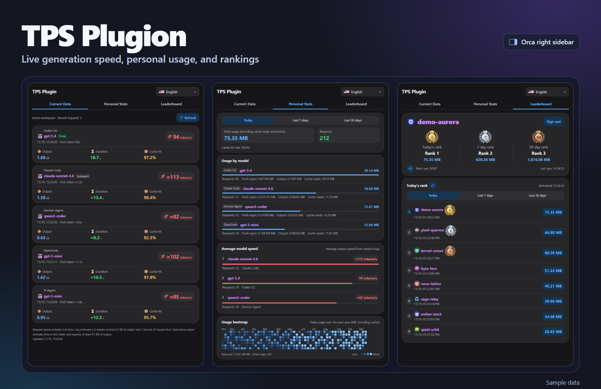
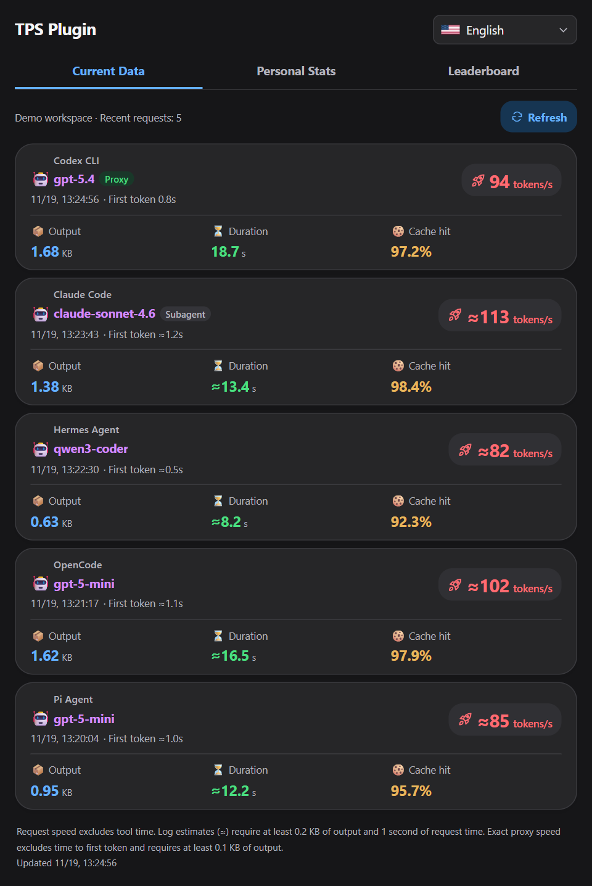
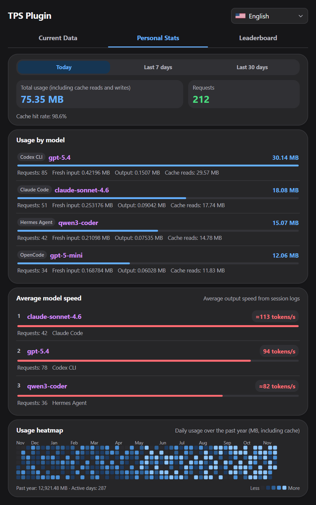
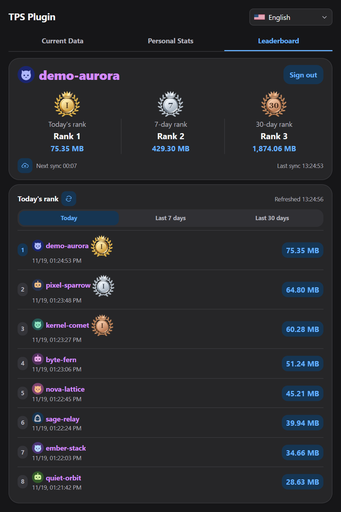

# TPS Plugion

**English** · **[简体中文](./README.zh-CN.md)** · **[Orca plugin directory](https://api.onorca.dev/plugins/jecyxyf/orca-tps-plugin)**

[](https://github.com/stablyai/orca)
[](https://github.com/jecyxyf/Orca-TPS-Plugin/actions/workflows/ci.yml)
[](./LICENSE)

## 1. Project description

TPS Plugion brings token usage and generation speed to the Orca sidebar. See what the current session is doing, review your usage over time, or join the leaderboard with a GitHub account.

The plugin supports local and SSH workspaces and remembers your choice of 10 interface languages. Conversation logs are read in place. The leaderboard receives usage totals.

## 2. Interface overview

Open **TPS Plugin** in Orca’s right sidebar to switch between **Current Data**, **Personal Stats**, and **Leaderboard**.



*The screenshots use sample data.*

## 3. Features

### 3.1 Current Data

- Follow the active Orca channel and view up to 100 recent requests.
- See the model, output in KB, generation speed in tokens per second, request duration, time to first token (TTFT) when available, and cache hit rate.
- Check the latest speed and cache hit rate in the Orca status bar. Estimated speeds are marked with ≈.



### 3.2 Personal Stats

- Review usage and request counts for today, the last 7 days, or the last 30 days.
- Break down usage by tool and model, and compare average model generation speeds. Usage in MB includes new input, output, cache reads, and cache writes.
- Use the annual heatmap to see daily activity over the past year.



### 3.3 Leaderboard

- Browse today’s, 7-day, and 30-day rankings. Entries show GitHub avatars, and the top three get gold, silver, and bronze medals.
- Sign in with GitHub to participate. The leaderboard combines usage across installations linked to the same account. The plugin fetches avatars directly from GitHub and uses a built-in hooded avatar while one is unavailable.
- While signed in, the plugin attempts to sync every 10 seconds. Manual sync shares the same interval. The account card shows the countdown, the last successful sync, and any recent error.



## 4. Supported Harnesses

- Codex CLI
- Claude Code (including subagents)
- OpenCode v1 and v2
- Pi Agent
- Antigravity CLI
- Hermes Agent

## 5. Installation

Use **Orca 1.4.251 or later** on Windows or Linux. To collect usage from an SSH workspace, the remote host needs **Node.js 22.13 or later with SQLite support**.

### Orca plugin directory

Find **TPS Plugion** in Orca’s plugin directory, review its permissions, and install it. [View the plugin listing](https://api.onorca.dev/plugins/jecyxyf/orca-tps-plugin)

### Git repository

To install from the main branch, run the following command and follow the approval prompt.

```sh
orca plugin install https://github.com/jecyxyf/Orca-TPS-Plugin.git --ref main
```

### Local installation

**Windows (PowerShell)**

```powershell
git clone https://github.com/jecyxyf/Orca-TPS-Plugin.git "$env:USERPROFILE\Applications\orca-tps-plugin"
Set-Location "$env:USERPROFILE\Applications\orca-tps-plugin"
./install-windows.ps1
```

**Linux**

```sh
git clone https://github.com/jecyxyf/Orca-TPS-Plugin.git ~/Applications/orca-tps-plugin
cd ~/Applications/orca-tps-plugin
sh install-linux.sh
```

If the Orca CLI is outside your PATH, set ORCA_CLI to its full path when running the Linux installer. Keep the clone in place while the plugin is loaded from it.

After installation, open **TPS Plugin** in Orca’s right sidebar.

[MIT License](./LICENSE) · [Third-party notices](./THIRD_PARTY_NOTICES.md) · [Leaderboard server guide](./server/README.md)
