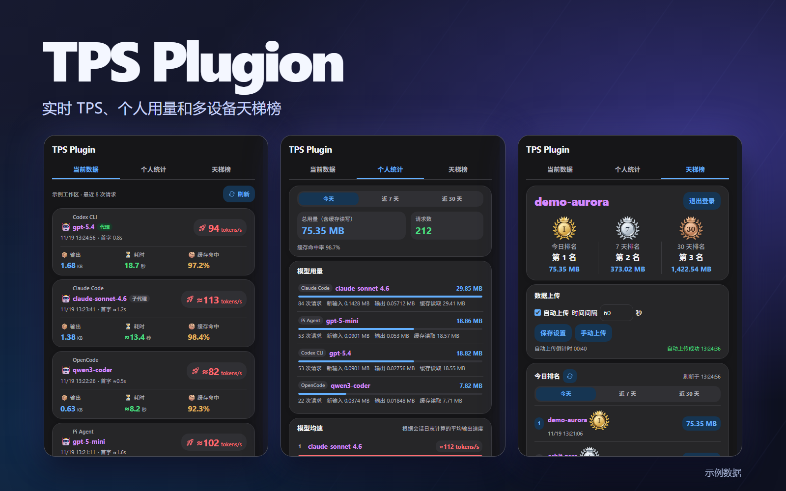
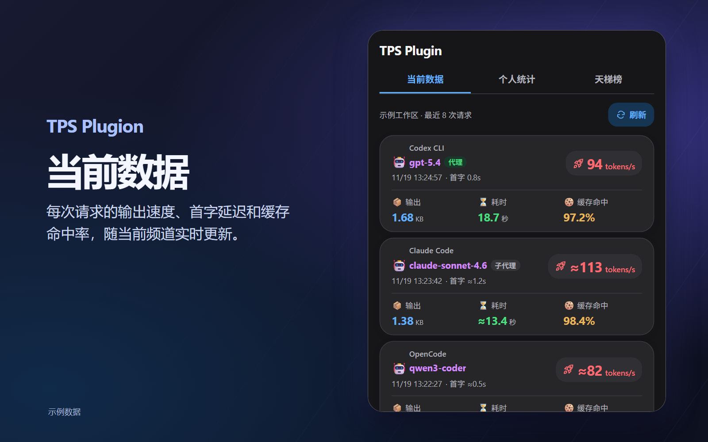
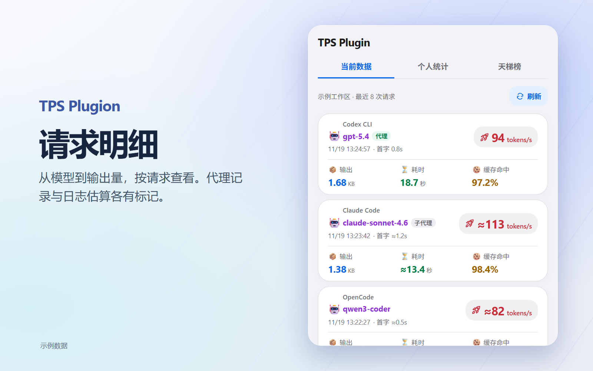
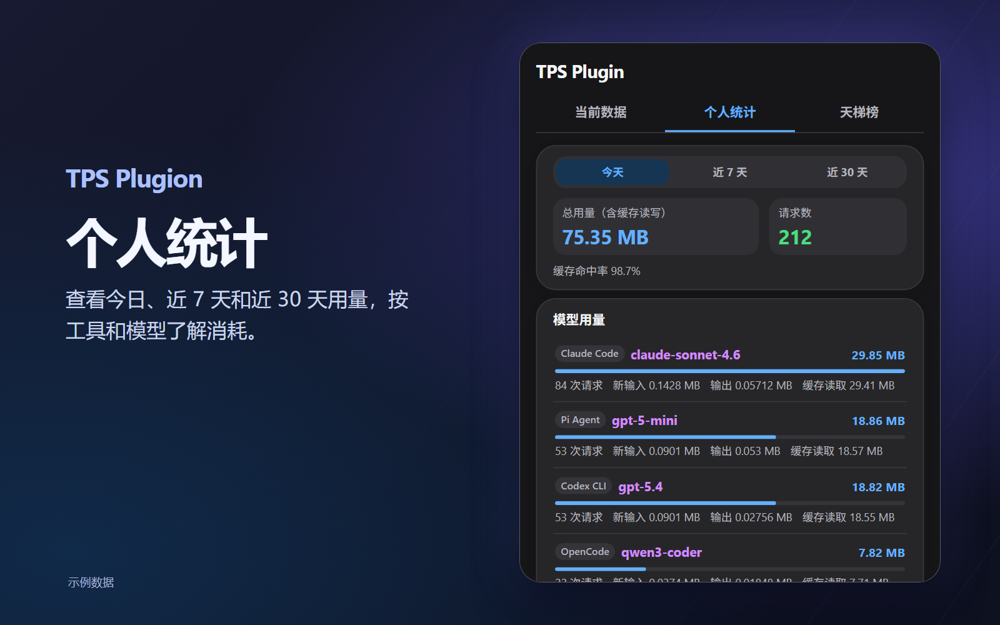
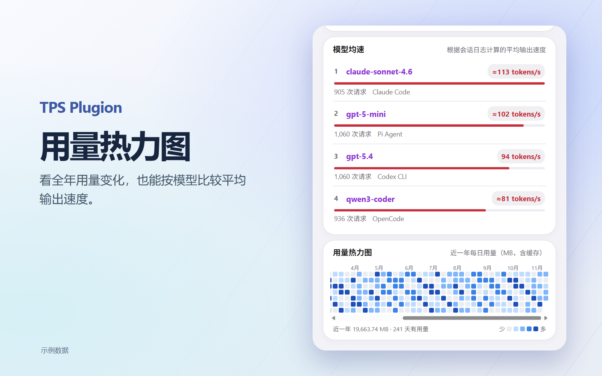
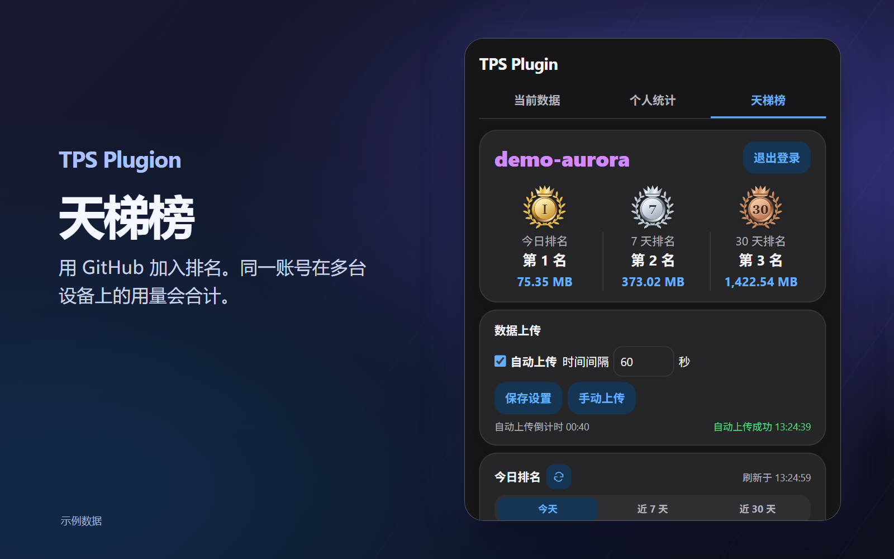
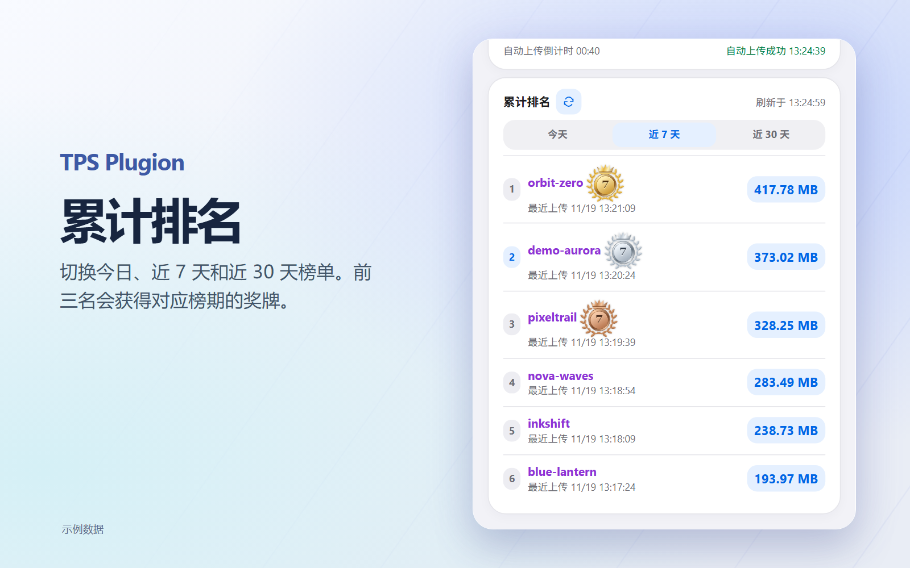

# TPS Plugion

**English** | **[简体中文](./README.zh-CN.md)** · **[Orca plugin directory](https://api.onorca.dev/plugins/jecyxyf/orca-tps-plugin)**

[](./LICENSE)
[](https://github.com/stablyai/orca)
[](https://nodejs.org/)
[](https://github.com/jecyxyf/Orca-TPS-Plugin/actions/workflows/ci.yml)



Track live request speed, review personal token usage, and compete on a shared leaderboard from the Orca sidebar. TPS Plugion supports Orca IDE 1.4.251 and later on Windows and Linux.

## Three views

| View | What you can see |
| --- | --- |
| **Current data** | The latest 100 requests in the active channel, with the model, output speed (TPS), time to first token (TTFT), output in KB, and cache hit rate. The status bar shows the latest speed and cache hit rate. |
| **Personal stats** | Today, rolling 7-day and 30-day totals, model usage and average speed, and a year of activity in a heatmap. Usage in MB includes new input, output, cache reads, and cache writes. |
| **Leaderboard** | Today, 7-day, and 30-day rankings with gold, silver, and bronze medals. Sign in with GitHub to upload manually or set automatic uploads with an interval of at least 10 seconds. Each installation reports its own totals, and the leaderboard combines them by account. |

TPS Plugion reads sessions from Claude Code (including subagents), Codex CLI, OpenCode v1 and v2, Pi Agent, and Antigravity CLI. It can also match requests with a local [CC Switch](https://github.com/farion1231/cc-switch) proxy database for more precise timing.

Remote project channels collect statistics on the remote host over the workspace's SSH connection. The remote host needs Node.js 22.13 or newer with SQLite support. Session files are read-only, conversation text stays where it is parsed, and leaderboard uploads contain usage totals.

## Screenshots

Screenshots use sample data.

| Dark theme | Light theme |
| :---: | :---: |
|  |  |
| **Current data** | **Request details** |
|  |  |
| **Personal stats** | **Usage heatmap** |
|  |  |
| **Leaderboard and uploads** | **Rolling rankings** |

---

## Calculation Methodology (CC Switch Parity)

### 1. Per-Provider Request Timing & Token Extraction

| Provider | Request Start | Request End (Excludes Tool Runtime) | TTFT & Token Rules |
| :--- | :--- | :--- | :--- |
| **Claude Code** | Groups multi-block streaming entries by `message.id` and walks `parentUuid` (up to 32 hops, skipping `attachment` nodes) to the triggering message timestamp | Maximum block timestamp once `stop_reason` is present | Infers TTFT from `thinkingDurationMs` when block `0` is `thinking`; merges `isSidechain`, `subagents/*.jsonl`, and `subagents/workflows/*/*.jsonl` |
| **Codex CLI** | `RequestTimer` locks onto the latest boundary (`turn_context`, user message, `*_output` tool result, or prior `token_count`) before first model output | Prefers matching `token_usage_record` timestamp or last model output before tool execution; falls back to `token_count` | Extracts TTFT from `item_completed` (`Reasoning` / `AgentMessage`) `started_at_ms`; deduplicates `limit_id` snapshots and normalizes model IDs |
| **OpenCode v1 / v2** | Message `time.created` (falls back to `time_created`) | **Prefers `time.streamed`** (end of streaming before tool execution); falls back to `time.completed` | Counts `tokens.output + tokens.reasoning` together; supports v2 `compaction` rows |
| **Pi Agent** | Explicit `duration` when present, else `message.timestamp` | `entry.timestamp` | Unpacks official `subagent` `toolResult` usage records without inheriting parent tool completion latency |
| **Antigravity CLI** | The step's own request start from agy's native store (`created`) | Start + first-token wait + stream time, all written by agy to the millisecond | TTFT is the first-token wait. Model is the generation's display name, then the latest `Model Selection` change, then the family name. Token counts come from the transcript, and `input_tokens` excludes cache reads. Without the native store only tokens and cache are shown |

### 2. Exact Proxy Speed vs. Session-Log Estimated Speed

| Mode | Source | Anti-Noise Threshold | Formula | Display Format |
| :--- | :--- | :--- | :--- | :--- |
| **Exact Proxy Speed** | Matching `2xx` `proxy` row in `~/.cc-switch/cc-switch.db` (exact `request_id` or `±600s` model + token semantic match) | `output_tokens >= 100` and post-TTFT window `latency_ms - first_token_ms >= 100ms` | $\dfrac{\text{output\_tokens}}{(\text{latency\_ms} - \text{first\_token\_ms}) \div 1000}$ | Exact value (e.g. `86`) with `代理` badge |
| **Estimated Log Speed** | Local CLI JSONL / SQLite session transcripts | `output_tokens >= 200` and plausible duration `1000ms <= latency_ms <= 1h` | $\dfrac{\text{output\_tokens}}{\text{latency\_ms} \div 1000}$ | Prefixed with `≈` (e.g. `≈68`); ineligible calls show `—` with reason tooltip |

- **Rounding**: `TPS >= 1` rounds to the nearest integer; `0 < TPS < 1` retains 1 decimal place.
- **Cache Hit Rate**: Normalizes fresh input tokens across providers as $\text{cache\_read} \div (\text{fresh\_input} + \text{cache\_creation} + \text{cache\_read})$; values `>= 99.95%` render as `100%`.

---

## Installation

### Option 1: Install via Orca Git / Catalog Source

This repository ships with both `orca-plugin.json` (Manifest v2) and `orca-catalog.json` (Catalog v2) for Orca `>= 1.4.251`:

```text
https://github.com/jecyxyf/Orca-TPS-Plugin.git
```

### Option 2: Local Clone on Linux

```sh
git clone https://github.com/jecyxyf/Orca-TPS-Plugin.git ~/Applications/orca-tps-plugin
cd ~/Applications/orca-tps-plugin
sh install-linux.sh
```

If `orca` is not on your default `PATH`, specify `ORCA_CLI`:

```sh
ORCA_CLI="$HOME/.config/orca/linux-orca-cli-shim/orca" sh install-linux.sh
```

### Option 3: Local Clone on Windows (PowerShell)

```powershell
git clone https://github.com/jecyxyf/Orca-TPS-Plugin.git "$env:USERPROFILE\Applications\orca-tps-plugin"
Set-Location "$env:USERPROFILE\Applications\orca-tps-plugin"
./install-windows.ps1
```

> **Note**: Keep the cloned directory in place while loaded in local development mode. To unload it later, run `orca plugin dev unload <directory>`.

### Orca Version Compatibility

| Orca Version | Status | Storage Schema Supported |
| :--- | :--- | :--- |
| **`>= 1.4.255`** | **Fully supported & optimized** (Tested on `1.4.255`) | Supports split document parts (`profile_state_document_parts`) with fast 250ms focus switching |
| **`1.4.251 - 1.4.254`** | Supported | Supports monolithic workspace session document (`profile_state_documents`) |
| **`< 1.4.251`** | Unsupported | Requires Orca plugin API v2 & status bar update support (`>= 1.4.251`) |

---

## Default Data Locations

The plugin reads the exact transcript/database path recorded by Orca for the focused terminal pane first, and only falls back to matching the exact session ID under default locations (never displaying another session's data):

| Source | Default Paths |
| :--- | :--- |
| **Codex** | `~/.codex/sessions`, Orca `codex-runtime-home/home/sessions`, managed Codex accounts |
| **Claude** | `~/.claude/projects` (including `<SESSION_ID>/subagents`), managed Claude profiles |
| **OpenCode / OpenCode 2** | `~/.local/share/opencode/opencode.db` (respects `OPENCODE_DB`, `XDG_DATA_HOME`) |
| **Pi** | `~/.pi/agent/sessions` (respects `PI_CODING_AGENT_DIR`) |
| **Antigravity CLI** | Tokens: `~/.gemini/antigravity-cli/brain/<conversation-id>/.system_generated/logs/transcript.jsonl` (live transcript only; rotated copies are ignored). Model and timing: `~/.gemini/antigravity-cli/conversations/<conversation-id>.db` (read-only; only step and generation metadata are read) |
| **CC Switch Proxy DB (Optional)** | `~/.cc-switch/cc-switch.db` (respects `CC_SWITCH_DB_PATH`) |

---

## Repository Structure

```text
Orca-TPS-Plugin/
├── assets/                   # Plugin icon, 16:10 cover, and six screenshots
├── src/
│   ├── worker.mjs            # Orca trusted-worker activation entry
│   ├── active-conversation.mjs # Read-only Orca active workspace/tab/pane resolver
│   ├── controller.mjs        # State sync, generation fencing, and status bar queue
│   ├── data.mjs              # Bounded JSONL reader, read-only SQLite, subagent & proxy merger
│   ├── data-paths.mjs        # Cross-platform Linux / Windows / macOS path resolution
│   ├── parsers.mjs           # CC Switch-aligned per-request parser & speed/cache formulas
│   └── panel.html            # Responsive sidebar HTML panel with light/dark theming
├── tests/                    # Unit and integration tests
├── .github/workflows/ci.yml  # Automated CI matrix for Ubuntu and Windows
├── install-linux.sh          # Linux validation & loader script
├── install-windows.ps1       # Windows PowerShell validation & loader script
├── orca-plugin.json          # Orca Plugin Manifest v2
├── orca-catalog.json         # Orca Plugin Catalog v2
├── README.zh-CN.md           # Simplified Chinese documentation (简体中文文档)
├── CHANGELOG.md              # Release history
├── THIRD_PARTY_NOTICES.md    # Open-source attributions
└── LICENSE                   # MIT License
```

---

## Development & Testing

```sh
# Run the tests (requires Node.js >= 22.13)
npm test

# Validate manifest, catalog, and tests via Orca CLI
orca plugin validate .
orca plugin validate orca-catalog.json
orca plugin inspect .
orca plugin test .
```

## License

Released under the [MIT License](./LICENSE). See [THIRD_PARTY_NOTICES.md](./THIRD_PARTY_NOTICES.md) for third-party attributions.
