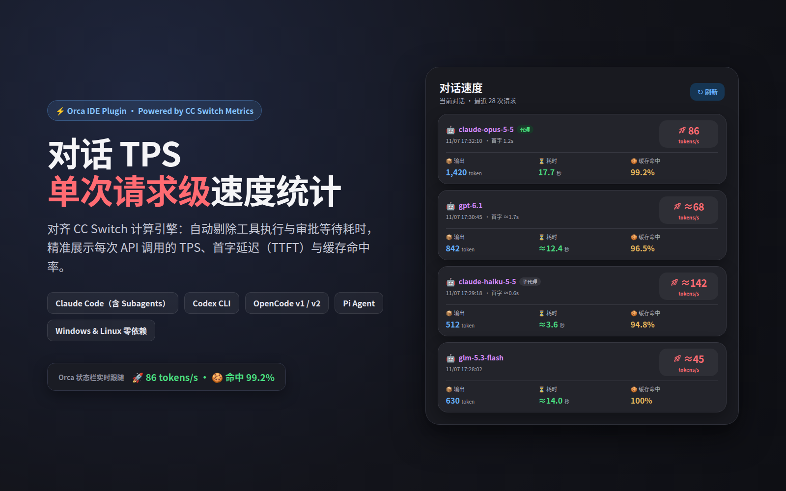
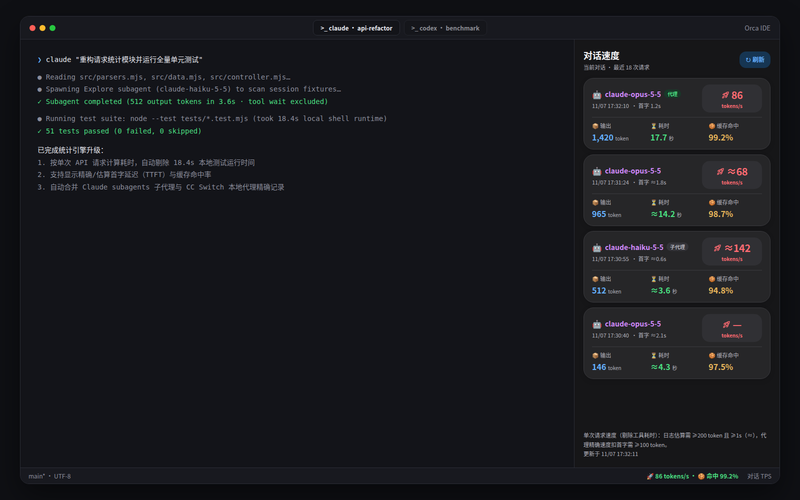
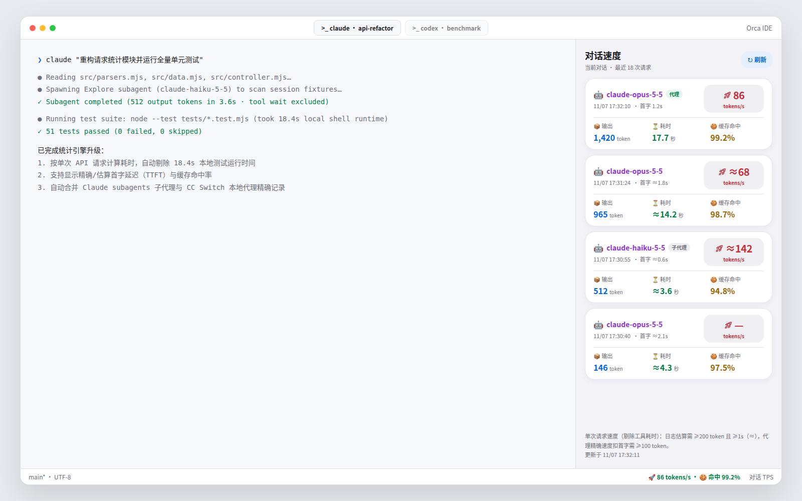

# Orca 软件 Tokens 统计插件

**[English Documentation (README.md)](./README.md)** | **简体中文**

[](./LICENSE)
[](https://github.com/stablyai/orca)
[](https://nodejs.org/)
[](https://github.com/jecyxyf/Orca-TPS-Plugin/actions/workflows/ci.yml)



适用于 **Orca IDE 1.4.251+（实测已深度适配 Orca 1.4.255+）** 的实时 Tokens 用量、单次请求输出速度（TPS）、首字延迟（TTFT）与缓存命中率统计插件。采用与 [CC Switch](https://github.com/farion1231/cc-switch) 完全一致的**单次 API 请求级**计算引擎，自动剔除本地工具执行与权限等待耗时，零外部依赖，原生支持 **Linux** 与 **Windows**。

---

## 核心特性

- **底部状态栏实时跟随**：显示当前项目频道最新一次 API 请求的输出速度和缓存命中率，点击即可刷新。
- **侧栏请求级明细卡片**：在「对话 TPS」查看当前频道各终端最近 100 次请求的模型、完成时间、首字延迟、输出 Token、耗时、TPS 和缓存命中率。
- **远程项目频道**：复用 Orca 的连接，由插件专用后台终端在项目所在机器采集统计。首次使用时需授权工作区和终端访问。远端需要支持 SQLite 的 Node.js 22.13 或更新版本，Orca 宿主接口需要 1.7 或更新版本。
- **严格剔除工具运行耗时**：不再用整轮挂钟时间充当分母，避免本地编译、测试脚本执行或权限确认弹窗拉低模型真实生成速度。
- **完整支持四大 CLI 与子代理**：原生解析本机终端中的 **Claude Code**（含 `<SESSION_ID>/subagents` 与 `workflows` 子代理）、**Codex CLI**、**OpenCode（v1 / v2）**、**Pi Agent** 与 **Antigravity CLI**，并支持只读融合 `~/.cc-switch/cc-switch.db` 本地路由代理的精确首字记录。
- **用量战况与热力图**：面板顶部提供「当日战况 / 近一周战况 / 近一月战况」，并附近一年的用量热力图（鼠标悬停查看每日数值）。统计范围包括 Claude Code、Codex、OpenCode、Pi 与 Antigravity CLI，汇总 token 总量（新输入、输出、缓存写入与缓存读取，与 CC Switch 的真实总量一致）、缓存命中率、请求数，并按 agent 与模型拆分。同一分组内还有「模型均速」排名（按模型的单次请求平均输出速度 tokens/s，基于本地会话日志，从高到低）。后台在本地增量统计，只保存计数，不保存对话内容。
- **战况天梯（可选开启）**：独立面板按 **当日 / 本月 / 本年** Token 总量排行，展示全榜前 100 与自己的精确名次（包括 100 名开外的名次）。**默认完全关闭**，加入排行是明确的主动操作。仅上传按日聚合的数字计数，绝不上传提示词、回复正文、项目名、路径或会话 ID。全网排行需要天梯服务端（见下文）；未配置服务端时，面板照常显示本机日/月/年战况。
- **只读会话数据**：解析器只读会话日志和数据库。远程项目通过 Orca 连接回传统计结果，提示词和回复正文留在解析端。

---

## 界面预览

| 深色主题（Dark） | 浅色主题（Light） |
| :---: | :---: |
|  |  |

---

## 计算方式与规则（对齐 CC Switch）

### 1. 各提供方请求耗时与首字提取

| 提供方 | 单次请求起点 | 单次请求终点（剔除工具耗时） | 首字时间（TTFT）与 Token 规则 |
| :--- | :--- | :--- | :--- |
| **Claude Code** | 按 `message.id` 聚合多内容块，沿首块 `parentUuid` 跳过 `attachment` 向上回溯（最多 32 跳）至触发消息时间戳 | 同一 `message.id` 具有 `stop_reason` 时的最大块时间戳 | 首块为 `thinking` 且含 `thinkingDurationMs` 时推算估算首字；自动合并 `isSidechain`、`subagents/*.jsonl` 与 `subagents/workflows/*/*.jsonl` |
| **Codex CLI** | `RequestTimer` 状态机锁定首条模型输出前的最近边界（`turn_context`、用户消息、工具 `*_output`、前序 `token_count`） | 优先取匹配的 `token_usage_record` 时间戳或工具输出前的模型输出终点，否则取 `token_count` | 从 `item_completed`（`Reasoning` / `AgentMessage`）的 `started_at_ms` 提取估算首字；支持 `limit_id` 快照去重与模型名归一化 |
| **OpenCode v1 / v2** | 消息记录 `time.created`（缺省回退 `time_created`） | **优先取 `time.streamed`**（流式生成结束时刻，不含后续工具执行），缺省回退 `time.completed` | 输出量计为 `tokens.output + tokens.reasoning`；同时支持 v2 `compaction` 消息 |
| **Pi Agent** | 优先读取显式 `duration`，否则取 `message.timestamp` | `entry.timestamp` | 支持展开官方 `subagent` 工具调用结果的用量明细（不继承父工具完成耗时） |
| **Antigravity CLI** | 原生会话库中该步骤自身的请求开始时间（`created`） | 开始时间 + 首字等待 + 流式时间，均为 agy 自身记录的毫秒值 | 首字时间即首字等待。模型名依次取：生成记录的显示名、最近一次「Model Selection」切换、模型族基础名。token 来自 transcript，`input_tokens` 不含缓存读取。没有原生库时只显示 token 和缓存 |

### 2. 精确速度 vs 日志估算速度门槛

| 模式 | 数据来源 | 防噪门槛 | 计算公式 | 显示格式 |
| :--- | :--- | :--- | :--- | :--- |
| **本地代理精确速度** | `~/.cc-switch/cc-switch.db` 中匹配的 `2xx` `proxy` 记录（精确 ID 或 `±600s` 同模型同 Token 语义匹配） | `output_tokens >= 100` 且纯生成时间 `latency_ms - first_token_ms >= 100ms` | $\dfrac{\text{output\_tokens}}{(\text{latency\_ms} - \text{first\_token\_ms}) \div 1000}$ | 无前缀（如 `86`），卡片带 `代理` 标签 |
| **会话日志估算速度** | 各 CLI 本机 JSONL / SQLite 会话记录 | `output_tokens >= 200` 且合理耗时 `1000ms <= latency_ms <= 1h` | $\dfrac{\text{output\_tokens}}{\text{latency\_ms} \div 1000}$ | 带 `≈` 前缀（如 `≈68`）；未达门槛显示 `—`（悬停提示原因） |

- **数值舍入**：`TPS >= 1` 四舍五入为整数，`0 < TPS < 1` 保留 1 位小数。
- **缓存命中率**：统一归一化净新输入后按 $\text{cache\_read} \div (\text{fresh\_input} + \text{cache\_creation} + \text{cache\_read})$ 计算；`>= 99.95%` 显示 `100%`，其余保留 1 位小数。

---

## 安装指南

### 方式一：通过 Orca 插件目录 / Git 仓库安装

可在支持 Git / Catalog 源的 Orca（`>= 1.4.251`）中直接引用仓库地址安装：

```text
https://github.com/jecyxyf/Orca-TPS-Plugin.git
```

### 方式二：Linux 本地克隆加载

```sh
git clone https://github.com/jecyxyf/Orca-TPS-Plugin.git ~/Applications/orca-tps-plugin
cd ~/Applications/orca-tps-plugin
sh install-linux.sh
```

若 `orca` 不在默认 `PATH` 中，可显式指定路径：

```sh
ORCA_CLI="$HOME/.config/orca/linux-orca-cli-shim/orca" sh install-linux.sh
```

### 方式三：Windows 本地克隆加载（PowerShell）

```powershell
git clone https://github.com/jecyxyf/Orca-TPS-Plugin.git "$env:USERPROFILE\Applications\orca-tps-plugin"
Set-Location "$env:USERPROFILE\Applications\orca-tps-plugin"
./install-windows.ps1
```

> **提示**：本地开发目录加载后请保留克隆目录；关闭终端不会卸载插件。如需移除本地开发挂载，可执行 `orca plugin dev unload <目录路径>`。

### Orca 版本兼容说明

| Orca 版本 | 兼容状态 | 状态存储机制支持 |
| :--- | :--- | :--- |
| **`>= 1.4.255`** | **全面支持并深度优化**（实测适配 `1.4.255`） | 支持按键拆分的增量文档部件（`profile_state_document_parts`），250ms 轻量快速切换响应 |
| **`1.4.251 - 1.4.254`** | 支持 | 支持整体工作区会话文档（`profile_state_documents`） |
| **`< 1.4.251`** | 不支持 | 需要 Orca 插件 API v2 与底部状态栏更新支持（`>= 1.4.251`） |

---

## 默认数据扫描位置

| 数据源 | 默认位置 |
| :--- | :--- |
| **Codex** | `~/.codex/sessions`、Orca 托管 `codex-runtime-home/home/sessions` 及多账户目录 |
| **Claude** | `~/.claude/projects`（含 `<SESSION_ID>/subagents`）、Orca 托管 Claude 账户目录 |
| **OpenCode / OpenCode 2** | `~/.local/share/opencode/opencode.db`（支持 `OPENCODE_DB`、`XDG_DATA_HOME`） |
| **Pi** | `~/.pi/agent/sessions`（支持 `PI_CODING_AGENT_DIR`） |
| **Antigravity CLI** | token：`~/.gemini/antigravity-cli/brain/<会话ID>/.system_generated/logs/transcript.jsonl`（只读实时 transcript，忽略轮转副本）。模型与耗时：`~/.gemini/antigravity-cli/conversations/<会话ID>.db`（只读，仅读取步骤与生成记录的元数据） |
| **CC Switch 代理库（可选）** | `~/.cc-switch/cc-switch.db`（支持 `CC_SWITCH_DB_PATH`） |

---

## 战况天梯

「战况天梯」面板把 Token 用量放进排行榜，分两部分：

- **本机战况（始终可用）**：本机 + 已授权的远程主机的**当日 / 本月 / 本年**汇总量，支持 **含缓存总量** 与 **净输入+输出** 两种口径。
- **排行榜（需要服务端）**：前 100 名，以及自己的精确名次、超越百分比、距前一名与距前 100 名的差值。周期按**当前自然日 / 自然月 / 自然年**计算，零点、每月 1 日、每年 1 月 1 日自动开新榜。

> **要启用全网排行，需要启动（或指向）一个天梯服务端。** 插件不内置任何公共地址。地址可在面板「设置」中修改，或在 Orca 设置 → 插件中填写。

### 启动内置服务端

仓库自带零外部依赖的服务端（`server/leaderboard-server.mjs`，要求 Node.js ≥ 22.13，使用内置 `node:sqlite`）：

```sh
# 本地测试：附带 115 名模拟选手，便于对照名次
node server/leaderboard-server.mjs --seed-demo

# 正式部署：指定监听与数据库位置
node server/leaderboard-server.mjs --host 0.0.0.0 --port 8787 --db /var/lib/orca-tps/leaderboard.db
```

| 参数 / 环境变量 | 用途 |
| :--- | :--- |
| `--host` / `LEADERBOARD_HOST` | 监听地址（默认 `127.0.0.1`） |
| `--port` / `LEADERBOARD_PORT` | 端口（默认 `8787`） |
| `--db` / `LEADERBOARD_DB` | SQLite 文件（默认 `~/.orca-tps-leaderboard/leaderboard.db`） |
| `--seed-demo` | 一次性写入 115 名模拟选手，便于测试排名位置 |
| `GITHUB_CLIENT_ID` | 启用 GitHub OAuth 设备码登录；未设置时面板只提供匿名加入 |

分享给他人前请在前面加 HTTPS（Caddy、Nginx 或隧道均可）：插件把登录凭据存在 Orca 加密的 `secrets:own` 中，面板也只接受 `http(s)` 地址。

### 加入方式与身份

- **匿名加入**：签发一个 `ORCA-XXXXXXXXXXXX` 恢复码，请妥善保存；在另一台机器输入即可找回同一个天梯账号。
- **GitHub 登录**（服务端配置了 `GITHUB_CLIENT_ID` 时）：走 OAuth 设备码流程，授权页通过 Orca 的 `shell.openExternal` 打开，访问令牌不会进入面板。
- **不使用 Orca 登录 ID 作为身份**：插件宿主 API 不提供任何账号或 Profile 标识；未登录 Orca Cloud 的本地 Profile 本身就是匿名的（`local-default`）。从磁盘猜测身份既不可靠也无法验签，因此天梯使用自己的凭据体系。

### 上传内容

仅按 `(来源域, 本地日期)` 上传：`realTokens`、`netTokens`、`requests`。来源域是不可逆哈希：

- `local:<hash>` —— 每台桌面端一个，本地生成。
- `remote:<hash>` —— 每个 SSH 端点一个（`host + port + username`），与远程采集使用的标识一致。

服务端按 `(用户, 来源域, 日期)` 幂等覆盖，因此多台桌面端扫描同一台远程服务器时**只计一次**；同一用户的名次为其各来源域之和，第二台机器是累加而不是覆盖。

### 隐私控制

- 在主动加入并开启同步之前，**不会上传任何数据**。
- **隐身模式**：在公开榜单中隐藏昵称与头像，仅自己面板可见名次。
- 退出天梯会删除已保存的令牌并停止所有上传。

---

## 开发与测试

```sh
npm test
orca plugin validate .
orca plugin inspect .
orca plugin test .
```

## 开源许可

本项目基于 [MIT License](./LICENSE) 开源。详见 [THIRD_PARTY_NOTICES.md](./THIRD_PARTY_NOTICES.md)。
